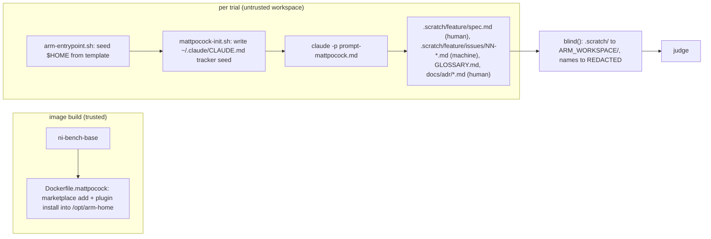

# mattpocock-arm — Design Doc

Amends: [benchmark design](./benchmark.md)

## Context

The benchmark compares Claude Code plugins on 7 scenarios across 4 arms (baseline, openspec, superpowers, ni). [mattpocock/skills](https://github.com/mattpocock/skills) (plugin `mattpocock-skills`, version 1.3.1 at commit `49dd158`, 2026-10-09) is a fifth candidate: 27 small composable skills covering planning (grilling, spec, tickets), debugging (diagnosing-bugs), and build (implement, tdd, code-review). Adding it as an arm answers whether its "small composable skills" approach beats the process-owning plugins on the same tasks.

The plugin has no single planning skill. Its planning route is a chain: `grill-with-docs` (interview + glossary + ADRs), then `to-spec`, then `to-tickets`. Every link in that chain is user-invoked (`disable-model-invocation: true`), so under the implicit prompts it would never fire, exactly the finding that produced the [explicit-flow track](../adrs/explicit-flow-track.md). The arm therefore enters the explicit track from day one: every scenario family gets a prompt-mattpocock variant naming the mapped skill chain.

## Functional Requirements

### <a id="fr1"></a>FR1 — Fifth subject arm `mattpocock`
A compose service `mattpocock` built from `arms/Dockerfile.mattpocock`, installing `mattpocock-skills` at image build time into the arm template HOME (same pattern as the superpowers and ni arms). It is registered in `harness/arms.py::ARMS` and reaches the smoke and matrix modes without further flags.

### <a id="fr2"></a>FR2 — Skill mapping per scenario family
One `scenarios/<id>/prompt-mattpocock.md` per scenario (7 files), each one slash-command line (the family's entry skill), then the control prompt, then exactly one appended line naming the rest of the arm's mapped workflow. The mapping is fixed by [ADR: skill mapping](../adrs/mattpocock-skill-mapping.md):

| Family | Scenarios | Mapped skills | Slash entry (first line) | Appended line |
|---|---|---|---|---|
| plan | plan-easy, plan-complex | `grill-with-docs` → `to-spec` → `to-tickets` | `/mattpocock-skills:grill-with-docs` | `Then use the to-spec and to-tickets skill workflow to publish the plan.` |
| debug | debug-easy, debug-complex, ported-debug | `diagnosing-bugs` | `/mattpocock-skills:diagnosing-bugs` | `Use the diagnosing-bugs skill workflow for this investigation.` |
| build | build-small, ported-build | `implement` (drives `tdd` and `code-review`) | `/mattpocock-skills:implement` | `Drive the implementation with the tdd and code-review skill workflow.` |

The entry skill is a slash command because the plugin's flagship skills are user-invoked (`disable-model-invocation: true`) and never appear in the Skill tool; see the Invocation section of the skill-mapping ADR.

### <a id="fr3"></a>FR3 — Headless tracker configuration
`to-spec`, `to-tickets`, and `implement` require an issue tracker configured by the interactive `/setup-matt-pocock-skills`. The arm seeds the equivalent configuration non-interactively, with the local-markdown tracker, per [ADR: tracker seed](../adrs/mattpocock-tracker-seed.md). The seed lives in the throwaway HOME, never in the fixture workspace, so the fixture diff stays authored content only.

### <a id="fr4"></a>FR4 — Artifact classification
The arm's authored markdown is classed for the two-audience judge:
- `.scratch/<feature>/spec.md`, `GLOSSARY.md`, `docs/adr/*.md`, any other authored `.md` → `human`
- `.scratch/<feature>/issues/*.md` (tickets, the agent's executable layer) → `machine`
- `.claude/**` → `excluded` (shared rule)

Artifact glob: `.scratch/**/*.md` (the produced-files set from `fixture.diff` adds `GLOSSARY.md` and `docs/adr/*.md` as it does for every arm).

### <a id="fr5"></a>FR5 — Blinding and report integration
The NFR4 blocklist and `scripts/check-blinding.sh` gain the identifiers the arm can leak: `mattpocock`, `pocock`, `ask-matt`, `grill-with-docs`, `grilling`, `grill`, `wayfinder`, `tracer-bullet`. The artifact-root regex gains `.scratch/`. `scripts/plugin-versions.sh`, `harness/report.py::PLUGIN_NAMES`, `scripts/check-isolation.sh`, and `docker-compose.yml` list the fifth arm. The report header states the arm's verbosity configuration as "default (no setting)".

### <a id="fr6"></a>FR6 — Documentation
The two workspace ADRs are promoted to `docs/20261001_benchmark/adrs/` at integration, the benchmark README lists the fifth arm, and the [scenario-matrix ADR](../adrs/scenario-matrix.md) bias table gains the mattpocock column (see [Failure modes](#failure-modes) for the known structural bias).

## Non-Functional Requirements

### <a id="nfr1"></a>NFR1 — Prompt parity with the explicit track
- **Scenario**: every prompt-mattpocock variant compared with its control prompt → one leading slash line, then the control prompt byte for byte, then one extra line containing the word `workflow`
- **Measure**: pass/fail
- **Verify**: `uv run pytest harness/tests/test_scenarios.py -q`

### <a id="nfr2"></a>NFR2 — Judge blinding holds for the new arm
- **Scenario**: adversarial samples naming the plugin, its skills, and `.scratch/` paths run through `blind()` → zero NFR4 matches
- **Measure**: pass/fail
- **Verify**: `uv run pytest harness/tests/test_judge.py -q && ./scripts/check-blinding.sh`

### <a id="nfr3"></a>NFR3 — Isolation holds for five arms
- **Scenario**: `check-isolation.sh` over the built images → `mattpocock` holds exactly `mattpocock-skills@mattpocock`, every other service unchanged
- **Measure**: pass/fail
- **Verify**: `./scripts/check-isolation.sh`

### <a id="nfr4"></a>NFR4 — Cost cap unchanged
- **Scenario**: full matrix 5 arms × 7 scenarios × n=3 = 105 trials
- **Measure**: spend under the existing 50 × n USD guard (the 84-trial matrix-v2 cost 10.81 USD; `implement` adds a `code-review` subagent pass per build trial, so the arm is expected to be the costliest, still inside the cap)
- **Verify**: `./scripts/cost-check.sh .reports/run-<timestamp>`

## Non-goals

- Running `wayfinder` for plan-complex. It is designed for multi-session efforts and produces decisions, not a plan document; the scenario asks for one implementable plan in one session, which is `to-spec`'s job. Documented in the skill-mapping ADR.
- Running `implement-spec` (parallel subagents in worktrees) for build scenarios. The fixture is one module; `implement` is the per-ticket flow the plugin's own router (`ask-matt`) names for a build that fits one session.
- A verbosity setting for the arm. The plugin ships none (checked every SKILL.md frontmatter and `plugin.json`); per the verbosity-policy ADR it runs at default and the report header says so.
- A GitHub or GitLab tracker inside the arm. The container has no forge credential and must not have one (isolation ADR).
- Changing the judge rubric or criteria for this arm. Criteria stay shared; the known bias is disclosed, not corrected.

## Rabbit holes

- **Simulator turn budget vs grilling rounds.** `grilling` asks the whole frontier each round and loops until the frontier is empty; the simulator cap is 6 user turns, then the trial is graded as-is. Do not raise the cap for this arm: the cap is a shared failure-mode constant and a plugin that needs more than 6 rounds to produce a plan is a measured result. Watch `user_turns` in the smoke run.
- **`to-spec` forbids file paths and snippets** while `plan-easy` criterion 3 (traceability) rewards naming `cli.py`, `build_parser`, `stats.summarize`. This is a structural bias against the arm. Do not patch the prompt or the criteria; record it in the bias table (FR6).
- **Official marketplace vs author marketplace.** Both install the same plugin; the official listing is sha-pinned and lagged main by two commits at the plugin author's last check. Pick one in the Dockerfile (ADR: skill mapping, section "install source") and stop.

## Failure modes

| Failure | Detection | Response | Blast radius |
|---|---|---|---|
| Agent stops at "run `/setup-matt-pocock-skills`" instead of planning | transcript shows the setup prompt; `user_turns` burned on config | FR3 seed prevents it; if it still appears, the seed text is wrong: fix the init hook, rerun smoke | one arm, plan family |
| Grilling never converges inside 6 user turns | `user_turns == 6`, no `.scratch/**/spec.md` | graded as-is (postcheck fail on plan family); disclosed as a result, not patched | one arm |
| Seed written into workspace instead of HOME | `fixture.diff` contains `docs/agents/` or `CLAUDE.md` the agent did not author | classify as `excluded` as a safety net; fix hook | one arm, artifact KPIs |
| Plugin name leaks to the judge through a skill name in prose | `check-blinding.sh` non-zero | extend blocklist, re-judge | judge inputs of one arm |
| Marketplace clone fails at build (SSH URL) | docker build error | the marketplace.json source is `./` (relative), fetched over HTTPS by `marketplace add mattpocock/skills`; no insteadOf rewrite expected, add one only if the build log shows `git@github.com` | build only |
| `implement` commits to the fixture branch | `git log` in workspace has arm commits | expected (superpowers and ni also commit); `fixture.diff` is computed against the baseline commit, unaffected | none |

## Design

Topology after the change: five subject services plus the harness service, one `docker compose run` per subject turn, unchanged runner loop.



Trust boundary: the image build runs on the trusted host; the trial workspace is untrusted agent output. Nothing new crosses the boundary: the seed is static text baked into the image, no credential is added (STRIDE: no new spoofing or disclosure surface; tampering with the seed by the agent only affects its own trial).

Sequence per plan-family trial:

```mermaid
sequenceDiagram
  participant R as runner
  participant A as mattpocock arm
  participant S as simulator
  R->>A: prompt-mattpocock.md (-p)
  A->>A: grill-with-docs: grilling round (Q1..Qn with recommendations)
  A-->>R: final message ends with questions
  R->>S: final message
  S-->>R: answers per brief ("your call" when uncovered)
  R->>A: --resume + answers
  A->>A: to-spec writes .scratch/slug/spec.md; to-tickets writes issues/NN-*.md
  A-->>R: asks for plan approval
  R->>S: final message
  S-->>R: "approved, task complete"
```

Decisions:
- [Skill mapping per scenario family and install source](../adrs/mattpocock-skill-mapping.md)
- [Headless tracker seed in the throwaway HOME](../adrs/mattpocock-tracker-seed.md)

## Data & migration
N/A: no persistence changes. Old run folders stay readable: the report renders arms present in the results dir and em-dashes absent ones.

## Cross-cutting Concerns
- Observability: the progress line, `matrix.json` plugin_overrides (gains `mattpocock`), and REPORT.md header carry the new arm.
- Rollout: the arm is additive; `./scripts/bench.sh smoke` (plan-easy, n=1) is the canary before any matrix run.
- Rollback: drop the `Arm` entry and the compose service; everything else is inert.
