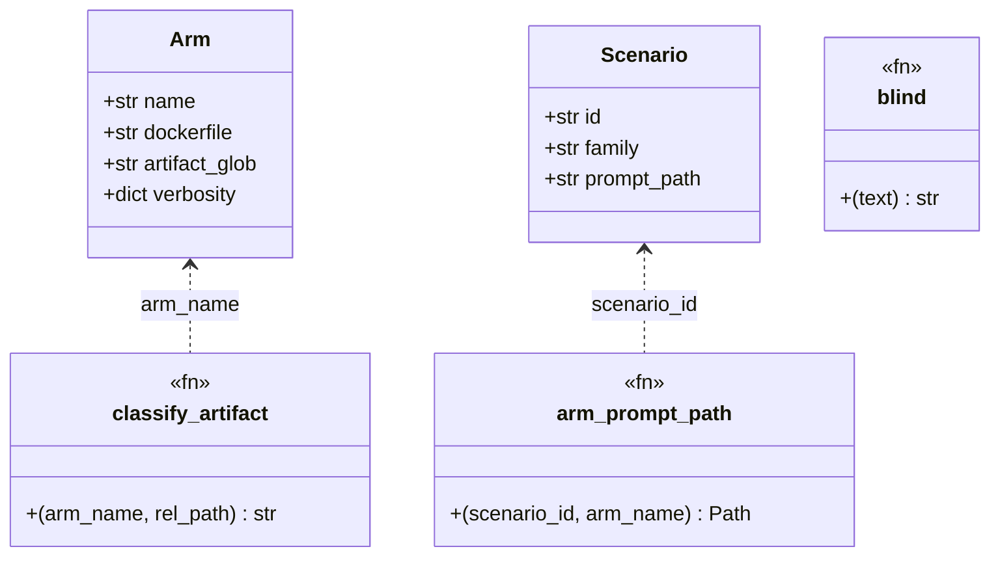

# mattpocock-arm — Tasks

Design: [DESIGN.md](./DESIGN.md)

## Analysis

Build: `./scripts/build.sh` — builds `ni-bench-base` then every compose service (requires Docker; not run during planning)
Test: `uv run pytest harness/tests -q` — 138 passed, 1 pre-existing failure (below)
Lint: `uv run ruff check harness` — verified green

### Known-failing tests
| Test | Reason | Action |
|---|---|---|
| `test_scenarios.py::test_scenario_files_complete` | `scenarios/*/postcheck.sh` (and `scripts/*.sh`) are committed with mode 100644 on `main`; the test asserts an executable bit | pre-existing on `main`, out of scope for this plan; fix in a separate `chore(repo): restore executable bits` commit via `git update-index --chmod=+x` before session 1's checkpoint |

### Domain model

The arm registry and the scenario resolver are the only types touched. No new type is introduced.

### Requirement traceability

| Type / Fn | Stability | Addresses | Notes |
|---|---|---|---|
| `Arm("mattpocock")` | internal | [FR1](./DESIGN.md#fr1), [FR4](./DESIGN.md#fr4) | `harness/arms.py::ARMS`, fifth entry, after `ni` |
| `classify_artifact` | internal | [FR4](./DESIGN.md#fr4) | new `mattpocock` branch |
| `arm_prompt_path` | internal | [FR2](./DESIGN.md#fr2) | unchanged code; new prompt-mattpocock variant files resolve through it |
| `blind` / `BLOCKLIST` / `_PATH_RE` | internal | [FR5](./DESIGN.md#fr5), [NFR2](./DESIGN.md#nfr2) | identifiers and `.scratch/` root |
| `PLUGIN_NAMES` (report) | internal | [FR5](./DESIGN.md#fr5) | header rows |
| REPORT.md header | published | [FR5](./DESIGN.md#fr5) | readers of past runs: additive row only, never rename existing rows |

### Transformations

| Function | Input → Output | Invariant / Rule |
|---|---|---|
| `classify_artifact("mattpocock", p)` | `.scratch/<f>/issues/<NN>-<slug>.md → "machine"` | only the `issues/` directory under `.scratch/<feature>/` is machine |
| `classify_artifact("mattpocock", p)` | `.scratch/<f>/spec.md`, `GLOSSARY.md`, `docs/adr/*.md`, `PLAN.md → "human"` | any other authored markdown is human |
| `classify_artifact("mattpocock", p)` | `.claude/** → "excluded"` | shared rule, unchanged |
| `blind(text)` | text with `mattpocock`, `pocock`, `ask-matt`, `grill-with-docs`, `grilling`, `grill`, `wayfinder`, `tracer-bullet` → `[REDACTED]` | word-bounded, case-insensitive; `grill` and `grilling` listed separately because `\b` does not match inside `grilling` for `grill` |
| `blind(text)` | `.scratch/<x>/... → ARM_WORKSPACE/<x>/...` | the dot is part of the root; regex must not require `\b` before `.` |
| `arm_prompt_path(sid, "mattpocock")` | `scenarios/<sid>/prompt-mattpocock.md` for all 7 scenarios | file exists for every scenario (unlike openspec, this arm has a debug flow) |
| `mattpocock-init.sh` | `$HOME` without seed → `$HOME/.claude/CLAUDE.md` with the Agent skills block | idempotent: existing file left untouched (resume turns) |
| `plugin-versions.sh` | built images → JSON with four keys `ni`, `superpowers`, `openspec`, `mattpocock` | exits 1 when any version is empty — from DESIGN.md failure modes |

## Tasks

### 1. Arm image and compose service ([FR1](./DESIGN.md#fr1), [FR3](./DESIGN.md#fr3), [NFR3](./DESIGN.md#nfr3))
**Goal**: a `mattpocock` compose service whose image holds exactly the plugin and the tracker seed hook.
**Types**: none (infrastructure)
**Constraints**:
- [ADR: skill mapping](./adrs/skill-mapping.md) — install from the author marketplace: `claude plugin marketplace add mattpocock/skills` then `claude plugin install mattpocock-skills@mattpocock`, `HOME=/opt/arm-home`, end with `claude plugin list` (version recorded in the build log)
- [ADR: tracker seed](./adrs/tracker-seed.md) — `arms/mattpocock-init.sh` writes the quoted `## Agent skills` block to `$HOME/.claude/CLAUDE.md` only when absent; copied with `--chmod=755` to `/opt/arm-init.d/`
- No credential ARG or ENV; no `insteadOf` rewrite unless the build log shows an SSH URL (DESIGN.md failure modes)
- `docker-compose.yml`: add `mattpocock` after `ni` with the shared `*common` anchor; update the header comment to "5 subject arms"
**Tests**:
- `scripts/check-isolation.sh` — add `check_plugins mattpocock "mattpocock-skills@mattpocock"` and a section-3 check that `run_in mattpocock cat /opt/arm-init.d/mattpocock-init.sh` exists; update the header comment to 6 services
- `harness/tests/test_isolation.py` — if it enumerates services, add `mattpocock`
**Verify**: `./scripts/build.sh && ./scripts/check-isolation.sh`
**Acceptance criteria**:
- [ ] `docker compose run --rm --no-deps -T mattpocock claude plugin list` prints exactly one plugin, `mattpocock-skills@mattpocock`, with a `Version:` line
- [ ] `docker compose run --rm --no-deps -T mattpocock cat /home/node/.claude/CLAUDE.md` prints the Agent skills block
- [ ] `./scripts/check-isolation.sh` exits 0
**Depends on**: (none)
**Time-box**: ~45 min

### 2. Arm registry and artifact classification ([FR1](./DESIGN.md#fr1), [FR4](./DESIGN.md#fr4))
**Goal**: the harness knows the arm, its artifact glob, and its two-audience layers.
**Types**: `Arm`, `classify_artifact`
**Constraints**:
- [ADR: tracker seed](./adrs/tracker-seed.md) — `.scratch/<feature>/issues/*.md` is machine; all other authored markdown is human
- `Arm(name="mattpocock", dockerfile="arms/Dockerfile.mattpocock", artifact_glob=".scratch/**/*.md", verbosity={})`, appended after `ni` so existing index-based tests (`ARMS[0]` is baseline) hold
- Docstring of `harness/arms.py` names the new classification rule and its ADR
**Tests** (`harness/tests/test_arms.py`):
- `test_mattpocock_tickets_are_machine` — `.scratch/json-output/issues/01-wire-flag.md` → `machine`
- `test_mattpocock_human_layer` — `.scratch/json-output/spec.md`, `GLOSSARY.md`, `docs/adr/0001-json-output.md`, `PLAN.md` → `human`
- `test_mattpocock_dot_claude_excluded` — covered by the parametrised `test_dot_claude_excluded_for_every_arm` through `ARM_NAMES`
**Verify**: `uv run pytest harness/tests/test_arms.py harness/tests/test_runner.py -q`
**Acceptance criteria**:
- [ ] `len(ARMS) == 5` and `ARMS[4].name == "mattpocock"`
- [ ] the three classification tests pass; every existing test in `test_arms.py` and `test_runner.py` still passes
**Depends on**: (none)
**Time-box**: ~30 min

### 3. Prompt variants for all seven scenarios ([FR2](./DESIGN.md#fr2), [NFR1](./DESIGN.md#nfr1))
**Goal**: the explicit-flow line per family, byte-parity with the control prompt.
**Types**: `arm_prompt_path` (unchanged)
**Constraints**:
- [ADR: skill mapping](./adrs/skill-mapping.md) — exact lines: plan family `Use the grill-with-docs, to-spec, and to-tickets skill workflow for this plan.`; debug family `Use the diagnosing-bugs skill workflow for this investigation.`; build family `Use the implement skill workflow to drive this implementation.`
- Each file is `prompt.md` content, trailing newline stripped, a blank line, the appended line, one trailing newline (same shape as [plan-easy/prompt-ni.md](../../../scenarios/plan-easy/prompt-ni.md))
**Tests** (`harness/tests/test_scenarios.py`):
- extend `PLUGIN_ARMS` with `"mattpocock"` so `test_arm_prompt_prefers_arm_variant_for_plan_family` covers it
- extend the debug and build loops in `test_arm_prompt_prefers_variant_for_debug_and_build_families` with `"mattpocock"` (it has a debug flow, unlike openspec)
- new `test_mattpocock_variant_parity_all_families` — for all 7 scenarios: prefix equals control, exactly one extra line, contains `workflow`
**Verify**: `uv run pytest harness/tests/test_scenarios.py -q -k "prompt or variant"`
**Acceptance criteria**:
- [ ] 7 files `scenarios/<id>/prompt-mattpocock.md` exist
- [ ] the parity tests pass for all 7
**Depends on**: (none)
**Time-box**: ~20 min

### 4. Blinding blocklist and artifact root ([FR5](./DESIGN.md#fr5), [NFR2](./DESIGN.md#nfr2))
**Goal**: the judge never sees the arm's name, skill names, or `.scratch/` root.
**Types**: `blind`, `BLOCKLIST`, `_PATH_RE`
**Constraints**:
- Transformation rows above: add `mattpocock`, `pocock`, `ask-matt`, `grill-with-docs`, `grilling`, `grill`, `wayfinder`, `tracer-bullet` to `BLOCKLIST` (longest first, keep the existing ordering rule); add `\.scratch/` to `_PATH_RE` without a leading `\b`
- `scripts/check-blinding.sh` pattern gains the same words and `\.scratch/`
- Ordinary words must survive: `grille`, `pocket`, `wayfarer`, `scratchpad` (no slash)
**Tests** (`harness/tests/test_judge.py`):
- add adversarial samples: `"mattpocock-skills@mattpocock installed"`, `"ran /grill-with-docs then /to-spec"`, `".scratch/json-output/issues/01-wire-flag.md"`, `"Matt Pocock's wayfinder map"`, `"tracer-bullet tickets"`
- extend `SURVIVOR_TEXT` with `grille`, `pocket`, `wayfarer`, `scratchpad`
- `test_blind_rewrites_scratch_root` — `.scratch/json-output/spec.md` → `ARM_WORKSPACE/json-output/spec.md`
- keep `NFR4_PATTERN` in the test in sync with `check-blinding.sh`
**Verify**: `uv run pytest harness/tests/test_judge.py -q`
**Acceptance criteria**:
- [ ] all adversarial samples blind to zero matches of the updated NFR4 pattern
- [ ] survivor text unchanged
**Depends on**: (none)
**Time-box**: ~30 min

### 5. Versions, report header, run entry ([FR5](./DESIGN.md#fr5))
**Goal**: the arm appears in `matrix.json`, the REPORT.md header, and the smoke matrix.
**Types**: `PLUGIN_NAMES`
**Constraints**:
- `scripts/plugin-versions.sh`: `MP_V="$(plugin_version mattpocock)"`, required non-empty, fourth JSON key `mattpocock`
- `harness/report.py`: `PLUGIN_NAMES = ("superpowers", "ni", "openspec", "mattpocock")`; the verbosity row for the arm reads "default (no setting)"; keep existing rows and wording byte-identical (REPORT.md header is `published`)
- `harness/run.py` needs no change (iterates `ARMS`); confirm by reading, not by editing
**Tests** (`harness/tests/test_report.py`):
- extend the header test with a `plugin_overrides` carrying `mattpocock` and assert the header row; assert the fallback `latest (n/a)` when absent
- assert the verbosity line names the arm as default
**Verify**: `uv run pytest harness/tests/test_report.py -q && bash -n scripts/plugin-versions.sh`
**Acceptance criteria**:
- [ ] a rendered header from a fixture results dir lists four plugin versions
- [ ] `test_report.py` green
**Depends on**: task 2
**Time-box**: ~30 min

### 6. Docs: ADRs promoted, README and scenario-matrix updated ([FR6](./DESIGN.md#fr6))
**Goal**: the arm and its disclosed bias are documented where the other arms are.
**Types**: none
**Constraints**:
- [README.md](../../../README.md) line 3 and section 2: four arms become five; matrix size `5 arms x 7 scenarios`; add the `mattpocock` verbosity line ("default, no setting") next to the existing per-arm notes if any
- [docs/20261001_benchmark/README.md](../../20261001_benchmark/README.md): list the two new ADRs under "ADRs (accepted)" once ratified, and mention five arms
- [scenario-matrix.md](../../20261001_benchmark/adrs/scenario-matrix.md) bias paragraph: add "to-spec forbids file paths, so plan-easy traceability is structurally against mattpocock"
- [verbosity-policy.md](../../20261001_benchmark/adrs/verbosity-policy.md): add the `mattpocock` bullet (no setting, runs default) and the tracker-seed asymmetry sentence
- [explicit-flow-track.md](../../20261001_benchmark/adrs/explicit-flow-track.md): one sentence that the fifth arm joins the explicit track for all three families
- Link lint from PREFLIGHT.md holds on every edited file
**Tests**: none (documentation); the Phase 6 integration step moves the workspace ADRs to `docs/20261001_benchmark/adrs/`
**Verify**: `grep -c mattpocock README.md docs/20261001_benchmark/README.md docs/20261001_benchmark/adrs/scenario-matrix.md docs/20261001_benchmark/adrs/verbosity-policy.md docs/20261001_benchmark/adrs/explicit-flow-track.md`
**Acceptance criteria**:
- [ ] every file in the verify command reports a count of at least 1
- [ ] both ADRs carry `status: accepted` after human ratification and live under `docs/20261001_benchmark/adrs/`
**Depends on**: tasks 1–5
**Time-box**: ~30 min

### 7. Smoke run and bias check ([NFR4](./DESIGN.md#nfr4), [FR3](./DESIGN.md#fr3))
**Goal**: one live plan-easy trial per arm proves the seed works and the skill chain produces artifacts.
**Types**: none
**Constraints**:
- Requires `.env` with `CLAUDE_CODE_OAUTH_TOKEN`; bills real spend (a few USD); never run on a host with secrets mounted into the repo
- Read `plan-easy/mattpocock/trial-01/turns/turn-01.json` and `simulator/transcript.json`: the first subject turn must not mention `/setup-matt-pocock-skills`
- `fixture.diff` must contain `.scratch/<slug>/spec.md` and at least one `issues/*.md`
- `./scripts/check-blinding.sh` on the run folder exits 0
**Tests**: live run, no unit test
**Verify**: `./scripts/bench.sh smoke && ./scripts/check-blinding.sh && ./scripts/cost-check.sh .reports/run-<timestamp>`
**Acceptance criteria**:
- [ ] `[5/5]` progress lines, zero indeterminate
- [ ] the mattpocock trial has `user_turns <= 6` and a `human` and a `machine` artifact in `result.json`
- [ ] REPORT.md header shows the four plugin versions and the arm's verbosity line
- [ ] no transcript line asks the user to run the setup skill
**Depends on**: tasks 1–6
**Time-box**: ~45 min (mostly wall-clock)

## Sessions

### Session 1 — harness and prompts (~2.5H)
Tasks: 2, 3, 4, 5, 1
**Skills**: `ni:software-engineer`, `ni:tdd`, `ni:git-conventions`
**Checkpoint**: `uv run pytest harness/tests -q && uv run ruff check harness && ./scripts/build.sh && ./scripts/check-isolation.sh`
**Commit point**: yes — one commit per task, conventional format (`feat(arms): ...`, `feat(scenarios): ...`, `feat(judge): ...`, `feat(report): ...`)

### Session 2 — docs and smoke (~1.5H)
Tasks: 6, 7
**Skills**: `ni:software-engineer`, `ni:git-conventions`, `ni:bias-analysis`
**Checkpoint**: `./scripts/bench.sh smoke && ./scripts/check-blinding.sh`
**Commit point**: yes — `docs(bench): fifth arm mattpocock-skills, ADRs accepted`; run artifacts stay git-excluded

## Quality gates (post-session review)
- [ ] Acceptance criteria: all green above
- [ ] Code review: implementation matches [DESIGN.md](./DESIGN.md) intent
- [ ] Code organization: arm files follow `arms/Dockerfile.<arm>` and `arms/<arm>-init.sh` naming
- [ ] Code quality: no new complexity; blocklist stays longest-first
- [ ] Security review: no credential in any image layer; seed carries no secret; `check-isolation.sh` green
- [ ] Observability: progress line, matrix.json, REPORT.md header carry the arm
- [ ] Performance: smoke spend inside the cost guard
